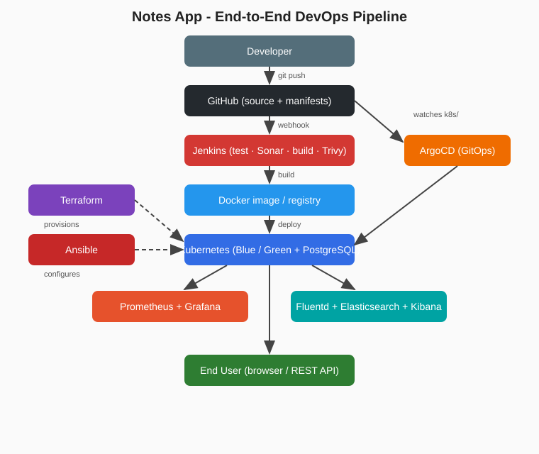
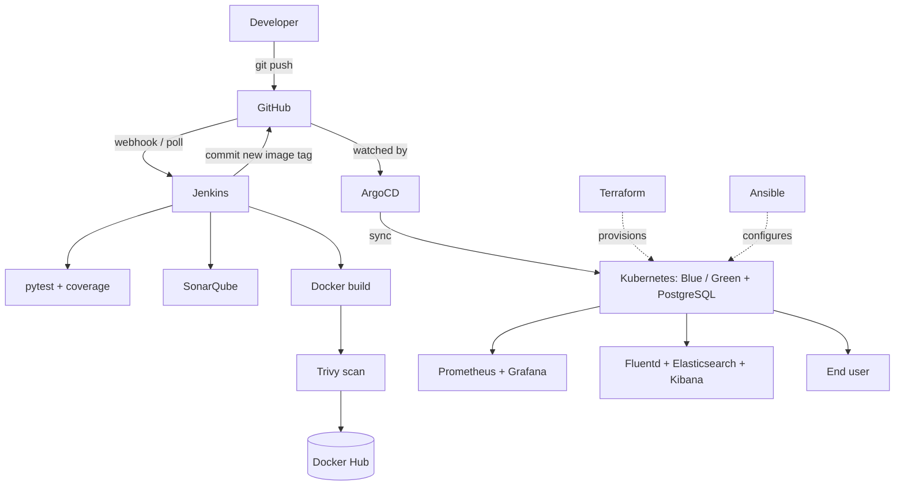

# Architecture

## Components
| Layer | Tool | Role |
|---|---|---|
| App | Flask, PostgreSQL | Notes with login, CRUD, REST API |
| Source control | Git/GitHub | Branches, merges, history |
| CI | Jenkins | Test → analyse → build → scan → package → push → update manifests |
| Container | Docker, Compose | Reproducible runtime |
| Orchestration | Kubernetes | Deployments, Services, ConfigMap, Secret, PV/PVC, RBAC |
| Config mgmt | Ansible | Installs Docker/K8s tools, deploys, configures |
| IaC | Terraform | Network, volume, DB and app containers via a module |
| Monitoring | Prometheus, Grafana | CPU, memory, container health, app metrics |
| Logging | Fluentd, Elasticsearch, Kibana | App, container and Kubernetes logs |
| Security | SonarQube, Trivy, RBAC, Secrets | Code, image, access and credential security |
| Release | Blue-Green | Zero-downtime switch + instant rollback |
| GitOps | ArgoCD | Cluster state follows Git |
